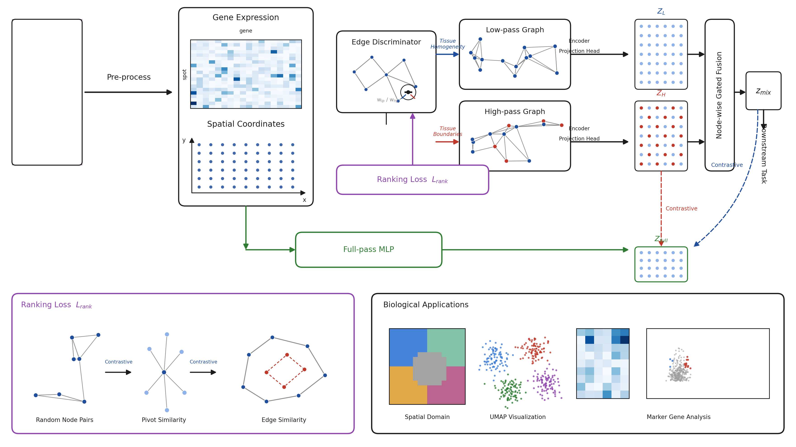

# DHALF

A dual-frequency graph representation framework for spatially resolved transcriptomics (SRT).
DHALF turns a spatial graph into a **low-pass (homophilic) view** and a **high-pass
(heterophilic) view** with a learnable **edge discriminator**, constrains both views with
**Full–Low / Full–High contrastive learning**, and fuses them through a **node-wise gate**.
The fused embedding `z_mix` is used for spatial domain identification, boundary recovery,
UMAP visualisation and downstream marker-gene analysis.



---

## Quick Result Validation Procedure for reviewers

```bash
conda create -n dhalf python=3.9 -y && conda activate dhalf
pip install -r requirements.txt          # plus torch / dgl / torch-geometric for your CUDA build
conda install -c conda-forge r-mclust rpy2 -y

chmod +x run.sh
GPU=0 ./run.sh 151673                    # or 151674 / E18_mouse_brain / Stereo_AB / BRCA
```

Each command runs the paper protocol (10 trials, seeds 0–9) and prints
`[FINAL RESULT] Dataset:... | Avg ARI:mean±std`. For a fast smoke test:

```bash
NTRIALS=1 EPOCHS=2 EVAL_FREQ=2 EVAL_AUX=0 SAVE_DIAGNOSTICS=0 ./run.sh 151673
```

---

## Environment Setup

Create a conda environment:

```bash
conda create -n dhalf python=3.9 -y
```

Activate the newly created environment:

```bash
conda activate dhalf
```

Install pip packages:

```bash
pip install -r requirements.txt
```

Install the PyTorch, DGL and PyTorch Geometric wheels that match your CUDA version when the
generic `pip` packages are incompatible, for example:

```bash
pip install torch==1.11.0+cu113 --extra-index-url https://download.pytorch.org/whl/cu113
pip install dgl-cu113==0.8.0 -f https://data.dgl.ai/wheels/repo.html
```

Install the R package `mclust` (used for standardized ARI evaluation). Without it the code
prints a warning and falls back to KMeans:

```bash
conda install -c conda-forge r-mclust rpy2 -y
```

A GPU is required: the Gumbel sampling and graph operators in `model.py` call `.cuda()`.

## GPU Settings

Set `-gpu` (or the `GPU` environment variable of `run.sh`) to the visible device index used by
your machine, for example:

```bash
python main.py -dataset BRCA -gpu 0 ...
GPU=1 ./run.sh Stereo_AB
```

## License

This project is released under the MIT License. See `LICENSE`.

## Dependencies

```
python==3.9.18
anndata==0.10.9
numpy==1.26.4
pandas==2.0.3
scanpy==1.9.3
scikit-learn==1.6.1
scipy==1.13.1
matplotlib==3.9.4
seaborn==0.13.2
torch==1.11.0
dgl==0.8.0
torch-geometric==2.0.4
rpy2==3.5.11            (optional, mclust backend)
```

The packages above are the main packages used in our experiments. Most CUDA-compatible PyTorch
environments can run the code directly; we also provide `./requirements.txt` for convenience.

## Data

Raw datasets are not redistributed in this repository. Please download the five benchmarks from
their original public sources and place them as follows (paths are relative to the repository
root, which must also be the working directory):

```
data/
├── 151673/                                  DLPFC 151673
│   ├── filtered_feature_bc_matrix.h5
│   ├── tissue_positions_list.csv
│   ├── metadata.tsv
│   └── spatial/{tissue_hires_image.png, tissue_lowres_image.png, scalefactors_json.json}
├── 151674/                                  DLPFC 151674
│   ├── filtered_feature_bc_matrix.h5
│   ├── cluster_labels_151674.csv
│   └── spatial/{tissue_positions_list.txt, tissue_hires_image.png,
│                tissue_lowres_image.png, scalefactors_json.json}
├── BRCA/Breast_Caner/                       Visium CytAssist human breast cancer
│   ├── filtered_feature_bc_matrix.h5
│   └── spatial/{tissue_positions_list.csv, brca_ground_truth_annotation.csv,
│                tissue_hires_image.png, tissue_lowres_image.png, scalefactors_json.json}
├── E18.5_mouse_brain/E18_adata_rna.h5ad     E18.5 mouse brain (MISAR-seq RNA)
└── Stereo/Stereo_AB.h5ad                    ARTISTA adult telencephalon
```

See `./data/README.txt` for a concise checklist of the required files and columns.

### Download sources

**DLPFC 151673 / 151674** (10x Visium human dorsolateral prefrontal cortex, Lieber Institute)

* Matrices: `https://spatial-dlpfc.s3.us-east-2.amazonaws.com/h5/<sample>_filtered_feature_bc_matrix.h5`
* Histology: `https://spatial-dlpfc.s3.us-east-2.amazonaws.com/images/<sample>_tissue_hires_image.png`
  (and `_tissue_lowres_image.png`)
* Positions / scalefactors: `https://raw.githubusercontent.com/LieberInstitute/HumanPilot/master/10X/<sample>/tissue_positions_list.txt`
  and `.../scalefactors_json.json`
* Layer annotations: exported from `spatialLIBD` (Bioconductor). `metadata.tsv` needs a
  `layer_guess` column; for 151674 either provide `cluster_labels_151674.csv`
  (`key`, `ground_truth`) or a `metadata.tsv` with `layer_guess`.

**BRCA** (10x Visium CytAssist human breast cancer)

* 10x Genomics public datasets: https://www.10xgenomics.com/datasets
  (search *Visium CytAssist Human Breast Cancer*)
* GEO example: https://www.ncbi.nlm.nih.gov/geo/query/acc.cgi?acc=GSM7782699

**Mouse E18.5 brain** (MISAR-seq RNA)

* Jiang et al., *Nature Methods*, 2023: https://www.nature.com/articles/s41592-023-01884-1
* Project page: https://www.biosino.org/node/project/detail/OEP003285
* Companion release: https://zenodo.org/record/7714382
* Save the RNA AnnData as `data/E18.5_mouse_brain/E18_adata_rna.h5ad`
  (annotation field: `Combined_Clusters`).

**Stereo_AB** (ARTISTA adult telencephalon)

* ARTISTA download: https://db.cngb.org/stomics/artista/download/
* Download `Adult.h5ad` and place/rename it to `data/Stereo/Stereo_AB.h5ad`
  (annotation field: `Annotation`).
* Dataset page: https://db.cngb.org/stomics/datasets/STDS0000056

## Quick start

Then reproduce the five benchmarks:

```bash
bash run.sh 151673
bash run.sh 151674
bash run.sh E18_mouse_brain
bash run.sh Stereo_AB
bash run.sh BRCA
```

Or run a single dataset directly:

```bash
python main.py -dataset 151673 -gpu 0 --seed 0 -ntrials 10 \
  -k 40 -refine_k 25 --temp_disc 1.0 -margin_hom 0.4 -margin_het 0.6 \
  --lambda_orig 0.0 --lambda_fl 1.0 --lambda_fh 1.0 --lambda_mix 1.0 \
  -epochs 600 -eval_freq 20 --result_name 151673
```

Spatial-domain maps, UMAPs, gate diagnostics and checkpoints are written to `./result`
(see [Outputs](#outputs)).

## Params setting for best results on each dataset in our environment settings

| Flag | Meaning | 151673 | 151674 | E18_mouse_brain | Stereo_AB | BRCA |
|------|---------|--------|--------|-----------------|-----------|------|
| `-k` | spatial neighbours | 40 | 40 | 30 | 20 | 8 |
| `-refine_k` | refinement neighbours | 25 | 25 | 10 | 15 | 5 |
| `-margin_hom` | homophilic margin | 0.4 | 0.4 | 0.3 | 0.4 | 0.6 |
| `-margin_het` | heterophilic margin | 0.6 | 0.6 | 0.7 | 0.6 | 0.4 |
| `-alpha` | high-pass coefficient | 0.1 | 0.1 | 0.1 | 0.1 | 0.1 |
| `--temp_disc` | discriminator temperature | 1.0 | 1.0 | 1.0 | 1.0 | 0.7 |
| `--gate_hidden` | node-gate width | 64 | 32 | 32 | 32 | 64 |
| `--sem_k` | semantic neighbours | 10 | 5 | 5 | 5 | 10 |
| `--lambda_orig` | weight of `L_base` | 0.0 | 0.1 | 0.1 | 0.1 | 0.0 |
| `--lambda_fl` | weight of `L_FL` | 1.0 | 1.0 | 1.0 | 1.0 | 1.0 |
| `--lambda_fh` | weight of `L_FH` | 1.0 | 0.5 | 0.75 | 0.25 | 0.0 |
| `--lambda_mix` | weight of `L_MIX` | 1.0 | 1.0 | 1.0 | 1.0 | 1.0 |
| `-lr_gcl` / `-lr_disc` | learning rates | 1e-4 | 1e-4 | 1e-4 | 1e-4 | 1e-4 |
| `-epochs` / `-eval_freq` | training length | 600 / 20 | 50 / 5 | 600 / 20 | 50 / 5 | 600 / 20 |

Reference ARI of the `z_mix` readout after spatial refinement:

| Dataset | ARI |
|---------|-----|
| DLPFC 151673 | 0.6344 (best checkpoint 0.6505) |
| DLPFC 151674 | 0.6533 |
| E18.5 mouse brain | 0.4711 (best checkpoint 0.4911) |
| Stereo_AB | 0.5438 |
| BRCA | 0.4228 |

The first four values are the ones reported in the paper; the BRCA value is the best run
recorded with the configuration above. Absolute numbers shift with the clustering backend
(mclust vs KMeans fallback), the number of trials and the checkpoint-selection protocol.

Default training schedule: `epochs=600`, `eval_freq=20`, `cl_rounds=2`, `emb_dim=512`,
`proj_dim=512`, `nlayers_enc=2`, `nlayers_proj=1`, `dropout=0.5`, `variant_d_gate_mode=node`,
`variant_d_warmup=0`, `use_hom_pos=1`, `ntrials=10`.

## Outputs

```
result/
├── <result_name>/                  spatial-domain map, UMAP, gate diagnostics,
│                                   cluster labels, embeddings, raw expression h5ad
├── checkpoints/                    best weights + run arguments per trial
├── variantD_summary.txt            appended text summary
└── variantD_151673_151674_runs.csv appended CSV with the full command of every run
```

`DHALF_SUMMARY_PATH` and `DHALF_RUN_CSV` redirect the two summary files.

## Applying DHALF to custom datasets

Prepare an AnnData / Visium-style input with spatial coordinates and (optionally) labels, place
it under `./data/`, and extend `data_loader.py` / `load_data()` accordingly. Then run:

```bash
python main.py -dataset <DATASET_NAME> -gpu 0 -k <spatial_knn> -refine_k <label_refine_knn> \
  -margin_hom <hom_margin> -margin_het <het_margin> -alpha <hp_scale> --temp_disc <temperature> \
  --result_name <DATASET_NAME>
```

Datasets without ground-truth labels need `--n_clusters_override <n>`.

## Reference

[1] J. Liu et al., "Dual-frequency graph representation learning for spatial domain
identification in spatially resolved transcriptomics," 2026.

[2] K. R. Maynard et al., "Transcriptome-scale spatial gene expression in the human dorsolateral
prefrontal cortex," *Nature Neuroscience*, 2021. (DLPFC 151673 / 151674)

[3] S. Jiang et al., "Simultaneous profiling of spatial gene expression and chromatin
accessibility during mouse brain development," *Nature Methods*, 2023. (MISAR-seq / E18.5)

[4] X. Wei et al., "Single-cell Stereo-seq reveals induced progenitor cells involved in axolotl
brain regeneration," *Science*, 2022. (ARTISTA / Stereo_AB)

[5] Y. Liu, Y. Zheng, D. Zhang, V. C. Lee, and S. Pan, "Beyond smoothing: Unsupervised graph
representation learning with edge heterophily discriminating," AAAI, 2023.

[6] W. Yang and B. Mirzasoleiman, "Graph contrastive learning under heterophily via graph
filters," arXiv:2303.06344, 2023.

## Acknowledgment

Parts of the graph contrastive design are inspired by heterophily-aware graph representation
learning methods such as GREET / HLCL-style edge discrimination and spectral filtering.
